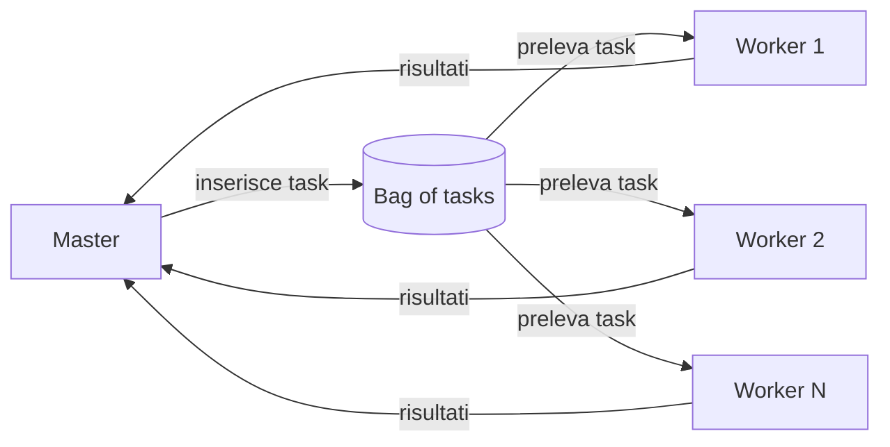
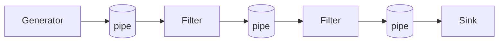
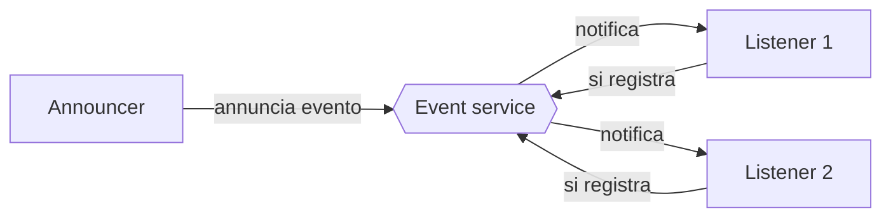

# Linee guida per progettare programmi concorrenti

## Passo 1: analisi del problema

> [!abstract] **Obiettivo**: identificare la decomposizione in task / dati e le loro dipendenze.

Una corretta analisi si divide in due step principali:
- **Task** and **Data** Decomposition Analysis;
- Dependency Analysis.

### Task and Data Decomposition Analysis

Bisogna scegliere quale tipo di decomposizione attuare.

##### 1. Task Decomposition Pattern

**Prima** si identificano i task, **poi** come decomporre i dati: la decomposizione dei dati **segue** quella dei task.
Esempio tipico: sistemi **produttori/consumatori**.

##### 2. Data Decomposition Pattern

**Prima** si identificano le unità di dato, **poi** i task relativi: la decomposizione dei task **segue** quella dei dati.
**Scala bene** con il numero di processori disponibili. Esempio tipico: **moltiplicazione di matrici**.

> [!hint] Indipendenza nella decomposizione
> In ogni caso la decomposizione deve essere fatta in modo che le singole parti siano il più **indipendenti** possibile fra loro, così da limitare il tempo speso nella gestione della concorrenza.

> [!example] In pratica
> Si può dividere per task (es. "mentre un componente scarica un file, un altro processa un'immagine") o per dati (es. "ho un array di 1 milione di elementi, ne do un quarto a testa a 4 processi diversi").

### Analisi delle dipendenze

Si analizzano le dipendenze tra i task della decomposizione per **raggruppare e ordinare** i task in base al tipo di dipendenza, così da **massimizzare le prestazioni**.

Tipi di dipendenze:
- **temporali** - "il task A deve essere finito prima che il task B inizi";
- sui **dati / risorse** - "il task A e il task B devono evitare race condition".

---

## Passo 2: design

Si sceglie un'**architettura concorrente** assegnando i task ad **agenti**, che per lavorare insieme sfruttano componenti **passivi** condivisi.

### Agenti e componenti passivi

> [!abstract] Definizione di agente
> Un **agente** è un **componente software attivo e autonomo** responsabile dell'esecuzione di uno o più task. Incapsula al suo interno la logica di controllo (il _"cosa fare e quando farlo"_) ed è in grado di interagire con altri agenti attraverso componenti passivi (risorse condivise o mezzi di coordinamento).

I componenti **passivi** sono di due tipi:
- **risorse condivise** che incapsulano il risultato del lavoro degli agenti;
- **risorse/media di coordinamento** che modellano l'interazione e gestiscono le **dipendenze** tra task.

> [!attention] **Disciplina attivo vs. passivo**
> Partizione **netta** tra le due categorie:
> - **componenti attivi** (agenti): incapsulano un **thread di controllo**, **nessuna interfaccia pubblica**, ogni interazione è **mediata dai componenti passivi condivisi**;
> - **componenti passivi**: progettati come **monitor**, incapsulano **mutua esclusione** e sincronizzazione.
>
> **Niente entità ibride**: un'entità ibrida si progetta come un insieme di uno o più componenti attivi e passivi.

### Classi concettuali

Per passare dall'analisi al design, si propongono **tre classi architetturali di base** [CAR-89]. Sono **modi di pensare** il parallelismo, ancora indipendenti dall'implementazione:

| Classe                     | Si guarda a...                         |
| -------------------------- | -------------------------------------- |
| **Result parallelism**     | la **forma del prodotto finito**       |
| **Specialist parallelism** | la **composizione della squadra**      |
| **Agenda parallelism**     | la **lista dei task da eseguire**      |

#### 1. Result parallelism

Strettamente legato al **data decomposition pattern**.
Si progetta il sistema attorno alla **struttura dati / risorsa** che costituisce il **risultato finale**.
- **Ogni agente** produce **un pezzo** del risultato; lavorano tutti in parallelo, entro i limiti naturali imposti dal problema.
- Si progettano **strutture dati condivise** che avvolgono il risultato in costruzione, **incapsulando mutex e sincronizzazione**.

> [!example] **Esempio: costruire una casa**
> Si pensa ai **componenti** della casa (pareti frontale, posteriore, laterali, pareti interne, fondamenta, tetto...) e si costruiscono **tutti insieme**, assemblandoli man mano che sono completati. Si usano **agenti separati** su parti diverse, in parallelo **fino al punto in cui un componente non può proseguire finché un altro non è finito**.

#### 2. Specialist parallelism

Si progetta il sistema attorno a un insieme di **specialisti** connessi in una **rete logica**.
- **Ogni agente** esegue **un tipo specifico di task**.
- Servono **mezzi di coordinamento** (protocolli di comunicazione, strutture dati condivise) per comunicazione e coordinamento _(es. **message box, blackboard, event service**)_.
- È l'approccio **opposto** al result parallelism.

> [!example] **Esempio: costruire una casa**
> Si identificano le **competenze** necessarie (geometri, scavatori, fondazioni, carpentieri, tetto...), cioè **tipi diversi di task**, e si forma una squadra in cui **ogni competenza è uno specialista**. Partono tutti insieme, ma all'inizio **molti devono aspettare**; a progetto avviato molte competenze lavorano in contemporanea.

#### 3. Agenda parallelism

Si progetta il sistema attorno a una **agenda di task** e si **assegnano molti worker a ogni passo**.
Si possono anche eseguire passi diversi in parallelo (workflow).
- **Ogni agente** aiuta con la voce **corrente** dell'agenda.
- Strutture dati condivise (es. **bounded buffer**) gestiscono i dati **consumati e prodotti** dalle attività.

> [!example] **Esempio: costruire una casa**
> Si scrive un'agenda **sequenziale** e la si segue **in ordine**, ma a ogni fase si assegnano **tutti o molti worker** all'attività corrente. Il team è composto da **generalisti**, ognuno capace di eseguire **qualsiasi passo**.

> [!hint] Nota
> **I confini non sono rigidi**: spesso si **mescolano** elementi di più approcci.
> > [!example] Esempio
> > Un approccio specialist può usare in modo secondario l'agenda parallelism, assegnando una **squadra di worker** a una specialità.
>
> L'approccio si può anche applicare **ricorsivamente**, seguendo la decomposizione di task e dati.

> [!info] **Come usarle** (adattato da [CAR-89])
> 1. scegliere la classe **più naturale** per il problema;
> 2. scrivere il programma con il metodo più naturale per quella classe;
> 3. se non è abbastanza efficiente, **trasformarlo metodicamente** in una versione più efficiente passando a un altro metodo.

---

## Architetture concorrenti

Le classi concettuali dicono *come pensare* il problema; le **architetture** dicono *come realizzarlo*

Ogni architettura è la stessa idea (agenti attivi + monitor in mezzo) con **un mezzo di coordinamento diverso**:

| Architettura            | Agenti                  | Mezzo passivo (monitor)      | Stile          |
| ----------------------- | ----------------------- | ---------------------------- | -------------- |
| **Master-Workers**      | master + worker         | **bag of tasks**             | task-oriented  |
| **Filter-Pipeline**     | generator, filter, sink | **pipe / bounded buffer**    | stream-based   |
| **Shared-Space**        | agenti pari             | **spazio / blackboard**      | space-based    |
| **Announcer-Listeners** | announcer + listener    | **event service**            | event-based    |

> [!question] Che legame c'è con le classi concettuali?
> Non c'è una mappa rigida (i confini sono sfumati), ma indicativamente:
> - **Master-Workers** → tipico dell'**agenda parallelism** (worker generalisti che prendono il task corrente dalla bag);
> - **Filter-Pipeline** e **Shared-Space** → tipici dello **specialist parallelism**;
> - il **result parallelism** è legato più a **strutture dati condivise** che a un'architettura a sé.

### Master-Workers

Detta anche _Manager-Workers_. Composta da un **master** e da un insieme (anche **dinamico**) di **worker**, che interagiscono tramite un **mezzo di coordinamento** che funziona da **bag of tasks**.

Il **Master**:
- **scompone** il task globale in **sotto-task**;
- li **assegna** inserendone la descrizione nella bag;
- **raccoglie i risultati**.

**Worker**: **prende** un task dalla bag, lo **esegue** e **comunica** il risultato.
**Bag of tasks**: tipicamente implementata come **blackboard** o **bounded buffer**.

> [!hint] **Variante**: si possono usare **monitor** apposta per **aggregare i risultati**.

#### Fork-Join

Variante di Master-Workers: applica **ricorsivamente** l'architettura, i **worker sono a loro volta master**, che producono task e ne raccolgono i risultati.

- Approccio efficace per realizzare strategie **divide-and-conquer concorrenti**.
- Si può realizzare con una **bag of tasks** oppure **direttamente**.
- Esempi: **quadratura adattiva**, **merge sort**.

#### Framework orientati ai task

Master-Workers si usa in pratica tramite i **task-oriented frameworks**.

> [!abstract] **Task** (livello dominio/problema)
> Unità di lavoro **astratta, discreta, indipendente**, **disaccoppiata dal concetto di thread**: sarà eseguita da qualche thread/processo del sistema. I task sono un'astrazione **più alta dei thread** (**concorrenza logica** vs. **concorrenza fisica**).

##### Task e programmazione asincrona

> [!abstract] **Idea chiave**
> L'esecuzione di un task avviene in modo **asincrono** rispetto al flusso di controllo che lo ha creato e sottomesso, quindi la **sottomissione non blocca** in attesa del completamento.

Nei framework orientati ai task ci sono **due ruoli distinti**:
- **chi sottomette** il task → fa da **master**;
- **chi lo esegue** → i **worker thread** dentro il framework.

> [!example] **Esempio: Java Executor framework**
> È un'architettura **master-worker**. Un task si sottomette a un _executor_ con `execute` o `submit`, che **ritorna subito** (può restituire un **future**). Il task è eseguito in modo asincrono da uno dei thread dell'executor, secondo la **politica** dell'executor.

> [!question] **Problema: come raccoglie i risultati il master?**
> Poiché i risultati sono calcolati in modo asincrono, si può usare:
> - una **bag of results**;
> - un **monitor collector/aggregator** progettato apposta;
> - il **meccanismo dei future**.

##### Meccanismo dei future

> [!abstract] Cosa sono i **future**
> Un oggetto che rappresenta il **risultato futuro** (o lo **stato**) di una computazione asincrona: è la risposta al problema qui sopra.

Lanciando una computazione asincrona (task) si crea e si restituisce **subito** un oggetto che rappresenta il **risultato futuro** (o lo **stato** della computazione).

L'oggetto può offrire operazioni per:
- **controllare lo stato** del task (_poll_);
- **bloccarsi** quando serve il risultato;
- **cancellare** il task in corso, quando possibile;
- **catturare errori/eccezioni** del task.

> [!tip] **Osservazione**
> Con task + future si ha programmazione **asincrona** ma **si permette ancora il comportamento bloccante**. Nella programmazione **event-driven** (vedi Announcer-Listeners) il comportamento bloccante **non è più ammesso**.

##### Virtual thread

Una vista logica simile a quella dei task è data dai **thread logici/leggeri** (_user-level thread_, _fibre_, _green thread_), **disaccoppiati dai thread fisici** (OS-level) usati per eseguirli. In Java sono i **virtual thread** (JDK 19 come _preview_, JEP 425, **progetto Loom**), trattati nel module-lab.

##### Structured concurrency

Si semplifica la programmazione concorrente con un'API per la **structured concurrency**:

- tratta **gruppi di task correlati**, eseguiti in thread diversi, come **una singola unità di lavoro**;
- **semplifica** gestione degli errori e cancellazione;
- migliora **affidabilità** e **osservabilità**.

![[Pasted image 20261110181944.png|363]]

### Filter-Pipeline

Catena **lineare** di agenti che interagiscono tramite **pipe / bounded buffer / canali**.

- **Generator**: avvia la catena, **genera i dati** da processare;
- **Filter**: agente **intermedio**, **consuma** informazione da una pipe e **produce** in un'altra;
- **Sink**: **termina** la catena, **raccoglie i risultati**.
### Shared-Space

Insieme di agenti che comunicano e interagiscono **indirettamente** tramite uno **spazio condiviso**, una risorsa che funziona da **blackboard** (mezzo di coordinamento).

- Lo spazio offre operazioni per **aggiungere** item di informazione e per **interrogare/recuperare/rimuovere** item, eventualmente con funzioni di **sincronizzazione**.
- **Caratteristiche**:
    - coordinazione **data-driven**;
    - **disaccoppiamento temporale**.

### Announcer-Listeners

Un **announcer** e un insieme **dinamico** di **listener** interagiscono tramite un **event service**.

- **Announcer**: **annuncia** l'occorrenza di eventi sull'event service;
- **Listener**: si **registrano** per essere notificati degli eventi di loro interesse;
- **Event service**: **disaccoppia** l'interazione, **raccoglie e smista** gli eventi.

