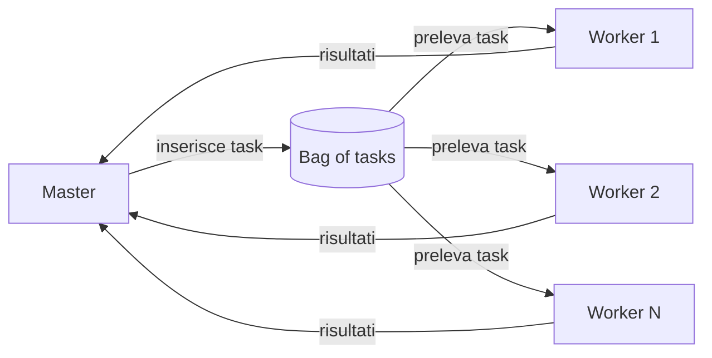
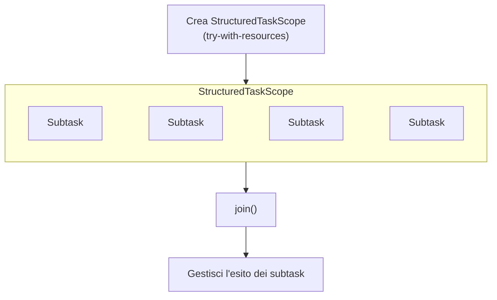
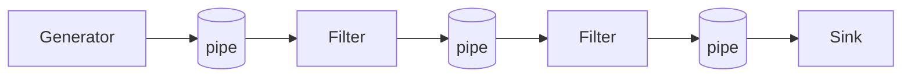
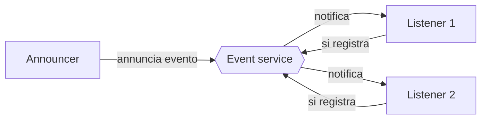

## Linee guida per progettare programmi concorrenti

Il processo di progettazione si divide in **due macro-passi**:

1. **Analisi** → individuare i **task** (e come decomporre i dati);
2. **Design** → scegliere un'**architettura concorrente**.

### Passo 1: Analisi

Si analizza il problema per **identificare la concorrenza sfruttabile**: decomposizione in task / dati e **dipendenze** tra di essi.

> [!info] **Task** Una **sequenza di istruzioni** che operano insieme come gruppo, corrispondente a una **parte logica** di un algoritmo o programma. È un lavoro specifico da svolgere come dovere/responsabilità di un _agente_: definizione **più astratta e orientata al design**.

### Passo 2: Design

Si sceglie un'**architettura concorrente** assegnando i task ad **agenti**:

- **agenti** = componenti **attivi**, responsabili dell'esecuzione dei task (incapsulano **logica e controllo**);
- per lavorare insieme, gli agenti usano componenti **passivi** condivisi:
    - **risorse condivise** che incapsulano il risultato del lavoro degli agenti;
    - **risorse/media di coordinamento** che modellano l'interazione e gestiscono le **dipendenze** tra task.

### Disciplina componenti attivi vs. passivi

**Partizione netta** tra le due categorie:

|Componenti **attivi** (agenti)|Componenti **passivi**|
|---|---|
|Incapsulano un **thread di controllo**|Progettati come **monitor**|
|**Nessuna interfaccia pubblica**|Incapsulano **mutua esclusione** e sync|
|Ogni interazione è **abilitata e mediata** dai componenti passivi condivisi|Sono il mezzo attraverso cui gli agenti interagiscono|

> [!warning] **Niente entità ibride** Un'entità ibrida si progetta come **un insieme di uno o più componenti attivi e passivi**.

---

## Passo 1 in dettaglio: analisi del problema

**Obiettivo**: identificare la decomposizione in task / dati e le loro dipendenze. Due sotto-passi:

- **Analisi della decomposizione** (task e dati);
- **Analisi delle dipendenze**.

### Task Decomposition Pattern

Seguendo il principio _divide et impera_, il problema si decompone in un insieme di task **indipendenti o quasi**.

- I task devono essere **abbastanza indipendenti**, in modo che gestire le dipendenze richieda solo una **piccola frazione** del tempo di esecuzione totale.
- **Prima** si identificano i task, **poi** come decomporre i dati: la decomposizione dei dati **segue** quella dei task.
- Esempio: sistemi **produttori/consumatori**.

### Data Decomposition Pattern

I dati del problema si decompongono facilmente in **unità** su cui si può operare in modo relativamente indipendente.

- **Prima** si identificano le unità di dato, **poi** i task relativi: la decomposizione dei task **segue** quella dei dati.
- **Scala bene** con il numero di processori disponibili.
- Esempio: **moltiplicazione di matrici**.

> [!tip] **Differenza** Cambia **da cosa si parte**: dai task (_task decomposition_) o dai dati (_data decomposition_).

### Analisi delle dipendenze

Si analizzano le dipendenze tra i task della decomposizione per **raggruppare e ordinare** i task in base al tipo di dipendenza, così da **massimizzare le prestazioni**.

Tipi di dipendenze:

- **temporali**;
- sui **dati / risorse**.

> [!quote] **Riferimento** Una classificazione delle dipendenze nei problemi di coordinamento è in [MAL-93] (tema **interdisciplinare**).

---

## Passo 2 in dettaglio: classi concettuali

Per passare dall'analisi al design, la letteratura [CAR-89] propone **tre classi architetturali di base**:

|Classe|Si pensa il parallelismo in termini di...|Si guarda a...|
|---|---|---|
|**Result parallelism**|il **risultato** del programma|la **forma del prodotto finito**|
|**Specialist parallelism**|un insieme di **specialisti** (la _crew_) che costituiscono il programma|la **composizione della squadra**|
|**Agenda parallelism**|l'**agenda di task** del programma|la **lista dei task da eseguire**|

### Result parallelism

Si progetta il sistema attorno alla **struttura dati / risorsa** che costituisce il **risultato finale**.

- Il parallelismo si ottiene calcolando **tutti gli elementi del risultato contemporaneamente**.
- Strettamente legato al **data decomposition pattern**.
- **Ogni agente** produce **un pezzo** del risultato; lavorano tutti in parallelo, entro i limiti naturali imposti dal problema.
- Si progettano **strutture dati condivise** che avvolgono il risultato in costruzione, **incapsulando mutex e sincronizzazione**.

> [!example] **Esempio: costruire una casa** Si pensa ai **componenti** della casa (pareti frontale, posteriore, laterali, pareti interne, fondamenta, tetto...) e si costruiscono **tutti insieme**, assemblandoli man mano che sono completati. Si usano **agenti separati** su parti diverse, in parallelo **fino al punto in cui un componente non può proseguire finché un altro non è finito**.

### Specialist parallelism

Si progetta il sistema attorno a un insieme di **specialisti** connessi in una **rete logica**.

- Il parallelismo nasce dal fatto che **tutti i nodi della rete** (tutti gli specialisti) sono **attivi simultaneamente**.
- **Ogni agente** esegue **un tipo specifico di task**.
- Servono **mezzi di coordinamento** (protocolli di comunicazione, strutture dati condivise) per comunicazione e coordinamento: es. **message box, blackboard, event service**.
- È l'approccio **opposto** al result parallelism.

> [!example] **Esempio: costruire una casa** Si identificano le **competenze** necessarie (geometri, scavatori, fondazioni, carpentieri, tetto...), cioè **tipi diversi di task**, e si forma una squadra in cui **ogni competenza è uno specialista**. Partono tutti insieme, ma all'inizio **molti devono aspettare**; a progetto avviato molte competenze lavorano in contemporanea. **Nota:** ruolo forte di **interazione e coordinamento** tra i worker (es. lavori in **pipeline**).

### Agenda parallelism

Si progetta il sistema attorno a una **agenda di task** (_activities_ in [CAR-89]) e si **assegnano molti worker a ogni passo**. Si possono anche eseguire passi diversi in parallelo (workflow).

- **Ogni agente** aiuta con la voce **corrente** dell'agenda.
- Strutture dati condivise gestiscono i dati **consumati e prodotti** dalle attività: es. **bounded buffer**.

> [!example] **Esempio: costruire una casa** Si scrive un'agenda **sequenziale** e la si segue **in ordine**, ma a ogni fase si assegnano **molti worker** all'attività corrente (fondazioni, struttura, tetto...). Il team è composto da **generalisti**, ognuno capace di eseguire **qualsiasi passo**.

### Confronto "costruire una casa"

|Classe|Chi sono i worker|Come lavorano|
|---|---|---|
|**Result**|uno per **componente** della casa|tutti i componenti in parallelo, finché non c'è dipendenza|
|**Specialist**|uno per **competenza** (specialisti)|tutti attivi, ma molti aspettano all'inizio|
|**Agenda**|**generalisti**, tutti capaci di tutto|**fase per fase**, molti worker sulla stessa fase|

### Osservazioni

> [!note] **I confini non sono rigidi** Spesso si **mescolano** elementi di più approcci. Es. un approccio specialist può usare in modo secondario l'agenda parallelism, assegnando una **squadra di worker** a una specialità. Restano comunque **tre modi distinti di pensare** al problema. L'approccio può essere applicato **ricorsivamente**, seguendo la decomposizione di task e dati.

### Come usare le classi concettuali

Per scrivere un programma concorrente (adattato da [CAR-89]):

1. scegliere la classe concettuale **più naturale** per il problema;
2. scrivere il programma con il **metodo più naturale** per quella classe;
3. se il programma **non è abbastanza efficiente**, trasformarlo **metodicamente** in una versione più efficiente passando da un metodo "naturale" a uno "efficiente".

---

## Architetture concorrenti

Alcune architetture specifiche aiutano a **colmare il divario** tra classe concettuale e implementazione ([MAG-99], [PAT-06]):

|Architettura|Famiglia|
|---|---|
|**Master-Workers** (e **Fork-Join**)|frameworks **orientati ai task**|
|**Filter-Pipeline**|pattern **basati su stream**|
|**Shared-Space / Blackboard**|coordinazione **basata su spazio**|
|**Announcer-Listeners**|coordinazione **basata su eventi**|

### Master-Workers

Detta anche _Manager-Workers_. Composta da un **master** e da un insieme (anche **dinamico**) di **worker**, che interagiscono tramite un **mezzo di coordinamento** che funziona da **bag of tasks**.

- **Master**:
    - **scompone** il task globale in **sotto-task**;
    - li **assegna** inserendone la descrizione nella bag;
    - **raccoglie i risultati**.
- **Worker**: **prende** un task dalla bag, lo **esegue** e **comunica** il risultato.
- **Bag of tasks**: tipicamente implementata come **blackboard** o **bounded buffer**.
- **Variante**: si possono usare **monitor** apposta per **aggregare i risultati**.

### Task e programmazione asincrona

> [!abstract] **Idea chiave** L'esecuzione di un task avviene in modo **asincrono** rispetto al flusso di controllo che lo ha creato e sottomesso: la **sottomissione non blocca** in attesa del completamento.

Nei framework orientati ai task ci sono **due ruoli distinti**:

- **chi sottomette** il task → fa da **master**;
- **chi lo esegue** → i **worker thread** dentro il framework.

> [!example] **Esempio: Java Executor framework** È un'architettura **master-worker**. Un task si sottomette a un _executor_ con `execute` o `submit`, che **ritorna subito** (può restituire un **future**). Il task è eseguito in modo asincrono da uno dei thread dell'executor, secondo la **politica** dell'executor.

> [!question] **Problema di seguito: come raccoglie i risultati il master?** Poiché i risultati sono calcolati in modo asincrono, si può usare:
> 
> - una **bag of results**;
> - un **monitor collector/aggregator** progettato apposta;
> - il **meccanismo dei future**.

### Framework orientati ai task

- **Task** = unità di lavoro **astratta, discreta, indipendente**, a livello **dominio/problema**.
- È **disaccoppiato dal concetto di thread**: sarà eseguito da qualche thread/processo del sistema.
- **Analisi e design orientati ai task**: analizzare il problema, identificare decomposizione e dipendenze.
- I task come **astrazione di programmazione** sono a **più alto livello dei thread**: **concorrenza logica vs. concorrenza fisica**.
- Esempio di framework/libreria: **Java Executors**.

### Meccanismo dei future

Lanciando una computazione asincrona (task) si crea e si restituisce **subito** un oggetto che rappresenta il **risultato futuro** (o lo **stato** della computazione).

L'oggetto può offrire operazioni per:

- **controllare lo stato** del task (_poll_);
- **bloccarsi** quando serve il risultato;
- **cancellare** il task in corso, quando possibile;
- **catturare errori/eccezioni** del task.

> [!tip] **Osservazione importante** Con task + future si ha programmazione **asincrona** ma **si permette ancora il comportamento bloccante**. Nella programmazione **event-driven** (slide successive) il comportamento bloccante **non è più ammesso**.

### Task e virtual thread

I task promuovono una **vista logica** della concorrenza (vs. la vista fisica dei thread OS). Una vista logica simile è data da framework/linguaggi che introducono un **thread logico/leggero**: _user-level thread_, _fibre_, _green thread_, **disaccoppiati dai thread fisici** (OS-level) usati per eseguirli.

- In Java: **virtual thread**, introdotti (come _preview_) in **JDK 19**, JEP 425 (https://openjdk.org/jeps/425).
- Risultato principale del **progetto Loom** (https://openjdk.org/projects/loom/).
- Trattati in un **module-lab**.

### Task e structured concurrency

Si semplifica la programmazione concorrente con un'API per la **structured concurrency**:

- tratta **gruppi di task correlati**, eseguiti in thread diversi, come **una singola unità di lavoro**;
- **semplifica** gestione degli errori e cancellazione;
- migliora **affidabilità** e **osservabilità**.

Proposta da JEP 425 (https://openjdk.org/jeps/425).

### Fork-Join

Applica **ricorsivamente** l'architettura master-worker: i **worker sono a loro volta master**, che producono task e ne raccolgono i risultati.

- Approccio efficace per realizzare strategie **divide-and-conquer concorrenti**.
- Si può realizzare con una **bag of tasks** oppure **direttamente**.
- Esempi: **quadratura adattiva**, **merge sort**.

### Filter-Pipeline

Catena **lineare** di agenti che interagiscono tramite **pipe / bounded buffer / canali**.

- **Generator**: avvia la catena, **genera i dati** da processare;
- **Filter**: agente **intermedio**, **consuma** informazione da una pipe e **produce** in un'altra;
- **Sink**: **termina** la catena, **raccoglie i risultati**.

Esempio: **image processing**.

### Shared-Space

Insieme di agenti che comunicano e interagiscono **indirettamente** tramite uno **spazio condiviso**, una risorsa che funziona da **blackboard** (mezzo di coordinamento).

- Lo spazio offre operazioni per **aggiungere** item di informazione e per **interrogare/recuperare/rimuovere** item, eventualmente con funzioni di **sincronizzazione**.
- **Caratteristiche**:
    - coordinazione **data-driven**;
    - **disaccoppiamento temporale**.
- Riferimento in letteratura: **tuple space** e linguaggio di coordinazione **Linda** [GEL-85][GEL-92].

### Announcer-Listeners

Un **announcer** e un insieme **dinamico** di **listener** interagiscono tramite un **event service**.

- **Announcer**: **annuncia** l'occorrenza di eventi sull'event service;
- **Listener**: si **registrano** per essere notificati degli eventi di loro interesse;
- **Event service**: **disaccoppia** l'interazione, **raccoglie e smista** gli eventi.

Esempio: **parallelizzazione di applicazioni event-driven**, ottenuta **parallelizzando l'esecuzione degli event handler**.

### Riassunto delle architetture

|Architettura|Agenti|Risorsa condivisa / mezzo|Esempi di problemi|
|---|---|---|---|
|**Master-Workers**|master + worker|**bag of tasks** (blackboard / bounded buffer)|(task-oriented)|
|**Fork-Join**|worker che sono anche master (ricorsivo)|bag of tasks o diretto|quadratura adattiva, merge sort|
|**Filter-Pipeline**|generator, filter, sink|**pipe / bounded buffer / canali**|image processing|
|**Shared-Space**|agenti pari|**spazio condiviso** (tuple space, Linda)|coordinazione data-driven|
|**Announcer-Listeners**|announcer + listener|**event service**|applicazioni event-driven|

---

## Rivisitare il Model-View-Controller

> [!attention] **Problema** Come **separare gli aspetti model / view / controller** nel design di programmi concorrenti complessi?

### Una prima mappatura

- **Controller** → incapsulato negli **agenti**: componenti **attivi**, incapsulano la **logica di controllo**;
- **Model** → **componenti passivi condivisi**: usati dagli agenti, incapsulano le **proprietà di mutex**, includono i **mezzi di coordinamento**;
- **View** → **componenti passivi condivisi**: **abilitano e mediano** l'interazione con gli utenti, sono **osservati e usati** dagli agenti, possono accedere al model per leggerne lo stato.

### Problemi (da discutere)

> [!question] **Toolkit GUI e thread-safety** Una scelta comune nei toolkit GUI è avere **un solo componente attivo** responsabile della GUI, con tutti i componenti GUI **non thread-safe**. Come gestirlo con l'approccio visto finora?

- Più in generale, MVC adotta un approccio **event-based** alle interazioni: **observer pattern**.
- L'observer **originale** è **sincrono** e implica **accoppiamento del controllo** (_control coupling_).

> [!tip] **Ripensare l'observer pattern per i sistemi concorrenti** Con un'architettura **produttore/consumatore**:
> 
> - il **bounded buffer** è una **coda di eventi**;
> - i **produttori** generano gli eventi;
> - i **consumatori** reagiscono e **consumano** gli eventi.

---

## Bibliografia

- **[CAR-89]** N. Carriero, D. Gelernter, _How to write parallel programs: a guide to the perplexed_, ACM Computing Surveys 21(3), 1989
- **[GEL-92]** D. Gelernter, N. Carriero, _Coordination languages and their significance_, Commun. ACM 35(2), 1992
- **[GEL-85]** D. Gelernter, _Generative communication in Linda_, ACM TOPLAS 7(1), 1985
- **[MAT-05]** T. Mattson, B. Sanders, B. Massingill, _Patterns for Parallel Programming_, Addison Wesley, 2005
- **[MAG-99]** J. Magee, J. Kramer, _Concurrency: State Models and Java Programs_, Wiley, 1999
- **[MAL-93]** T. W. Malone, K. Crowston, _The interdisciplinary study of coordination_, MIT Sloan, 1993